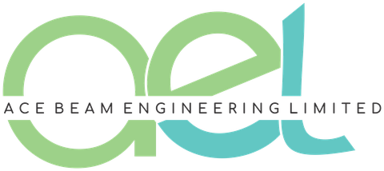

<div align="center">

  

  # Acebeam Engineering Limited (AEL)
  ### Multi-Disciplinary Industrial Engineering, Automation & Turnkey EPC Contractor
  **CAC Registration: RC 1885530 &bull; Lagos, Nigeria**

  <p align="center">
    <a href="https://acebeamel.com">
      
    </a>
    <a href="https://acebeamel.com">
      
    </a>
    <a href="https://wa.me/2348037646371">
      
    </a>
  </p>

</div>

---

## 📌 Executive Overview

**Acebeam Engineering Limited (AEL)** is an indigenous Nigerian engineering solutions contractor incorporated under the Companies and Allied Matters Act (RC 1885530). 

AEL provides turnkey industrial engineering services, factory automation, mechatronics, plant fabrication, construction administration, and specialized technical manpower for multi-national manufacturing conglomerates, oil & gas facilities, food and beverage processing plants, and commercial infrastructure nationwide.

* **Corporate Headquarters:** KM 32, Lagos-Badagry Expressway, Morogbo / Agbara Industrial Corridor, Lagos State, Nigeria.
* **Official Web Portal:** [https://acebeamel.com](https://acebeamel.com)
* **Direct Engineering Desk:** `+234 803 764 6371` | `info@acebeamel.com`

---

## ⚙️ 9 Core Engineering Divisions

This web platform showcases AEL's complete multi-disciplinary engineering portfolio across nine specialized operating divisions:

| Division | Discipline | Key Technical Scope |
| :---: | :--- | :--- |
| **01** | **Mechanical & Mechatronics** | CNC milling, heavy-duty alloy machining, precision machine design, and conveyor handling systems. |
| **02** | **Electrical, Control & Instrumentation** | Motor Control Centers (MCC), industrial switchgear, VFD parameterization, and pressure/flow sensors. |
| **03** | **Automation & Robotics Systems** | Programmable Logic Controllers (PLC), SCADA supervisory dashboards, telemetry, and robotic workcells. |
| **04** | **Construction Administration** | QA/QC compliance, structural blueprint reviews, site inspections, and contractor oversight. |
| **05** | **Turnkey EPC & Project Management** | End-to-end design, procurement, structural fabrication, plant piping skids, and commissioning. |
| **06** | **Fire Protection & Safety Engineering** | Automatic deluge valve manifolds, fire sprinkler risers, suppression engineering, and safety audits. |
| **07** | **Engineering Consultancy & Feasibility** | Technical feasibility studies, P&ID diagram design, structural calculations, and CAD drafting. |
| **08** | **Technical Manpower & Personnel** | Certified 6G pipe welders, instrumentation engineers, maintenance millwrights, and HSE coordinators. |
| **09** | **Environmental Resource Management** | Industrial Effluent Treatment Plants (ETP), waste minimization, and aeration basin engineering. |

---

## 🚀 Key Web Engineering Features

* **Authentic Industrial Photography:** 100% verified, real-world engineering photography across all service cards and project showcases with zero synthetic or AI-generated stock illustrations.
* **Brand Compliance:** Custom palette implementing official brand guidelines (`#62C6C2` Acebeam Turquoise, `#9DD089` Acebeam Green, `#0B111E` Deep Navy) with Montserrat and Comfortaa typography.
* **Single-Line Responsive Header:** Unified, mathematically balanced navigation locked to a single horizontal row (`flex-wrap: nowrap`) with active Scrollspy scroll indicators and responsive tablet drawer.
* **Moveable WhatsApp Connect Widget:** Custom draggable floating widget (`52px` circular footprint) that prevents content obstruction while providing seamless WhatsApp communication.
* **cPanel Native Mailer (`mail.php`):** High-speed, server-side quotation request processor featuring envelope sender verification (`-finfo@acebeamel.com`), anti-bot honeypots, and client auto-responders.
* **Enterprise SEO & Knowledge Graph:** 
  * Schema.org `Corporation` & `WebSite` JSON-LD structured data with entity aliases (`["AEL", "Acebeam", "AcebeamEL", "AEL Nigeria"]`).
  * Open Graph and Twitter Card rich social sharing metadata.
  * XML Sitemap (`sitemap.xml`) and search crawler directives (`robots.txt`).

---

## 🛠️ Technology Stack

* **Frontend:** Semantic HTML5, CSS3 (Modern Flexbox / Grid / Custom CSS Properties), Vanilla JavaScript (ES6+).
* **Icons & Fonts:** Font Awesome 6.4 Free, Google Fonts (Montserrat & Comfortaa).
* **Backend Mailer:** Native PHP 7.4 / 8.x (`mail.php`) with cPanel Exim MTA integration.
* **Server Architecture:** Apache with `.htaccess` (HTTPS enforcement, Gzip compression, and browser caching).

---

## 📂 Repository File Structure

```text
acebeam-website/
├── .htaccess                           # Production Apache configuration (HTTPS, Gzip, Caching)
├── CPANEL_DEPLOYMENT_GUIDE.md          # Step-by-step cPanel extraction and hosting instructions
├── README.md                           # Corporate documentation and repository overview
├── favicon.ico                         # Multi-resolution favicon icon
├── googlef9598932901b0fb7.html         # Google Search Console ownership verification token
├── index.html                          # Production flagship single-page application
├── mail.php                            # Server-side RFQ contact mailer for cPanel
├── robots.txt                          # Search engine bot directives and sitemap reference
├── sitemap.xml                         # Production XML sitemap for Google/Bing indexing
└── assets/
    ├── css/
    │   └── style.css                   # Master brand styling, animations, and responsive queries
    ├── js/
    │   └── main.js                     # Scrollspy, draggable WhatsApp widget, and form handler
    └── images/
        ├── acebeam_logo.png            # Official high-resolution company emblem
        ├── about_corporate_facility.jpg# Real plant stainless process manifold
        ├── hero_industrial_bg.jpg      # Industrial refinery background hero
        ├── favicon*.png                # Centered 'ae' monogram icon set (16x16 up to 512x512)
        ├── projects/                   # Authenticated project track record photography
        │   ├── mcc_switchgear_panel.jpg
        │   ├── process_piping_skid.jpg
        │   └── scada_automation_control.jpg
        └── services/                   # Authentic photography for each of the 9 divisions
            ├── automation_robotics.jpg
            ├── construction_administration.jpg
            ├── consultancy_services.jpg
            ├── electrical_instrumentation.jpg
            ├── environmental_management.jpg
            ├── fire_safety_engineering.jpg
            ├── manpower_recruitment.jpg
            ├── mechanical_engineering.jpg
            └── project_management.jpg
```

---

## 🌐 Production Deployment

The production site is hosted on cPanel and accessible globally:

👉 **[https://acebeamel.com](https://acebeamel.com)**

To deploy updates to cPanel:
1. Upload the repository contents (or pre-built `.zip`) directly into `public_html/`.
2. Ensure file permissions: Folders `755`, Files `644`.
3. Verify HTTPS redirect and test form submission to `info@acebeamel.com`.

---

## 📞 Corporate Contact & Legal

* **Corporate Name:** Acebeam Engineering Limited
* **Trading Name:** AEL
* **CAC Registration Number:** RC 1885530
* **Head Office:** KM 32, Lagos-Badagry Expressway, Morogbo / Agbara, Lagos State, Nigeria.
* **Direct Telephone:** [+234 803 764 6371](tel:+2348037646371)
* **General Inquiries:** [info@acebeamel.com](mailto:info@acebeamel.com)
* **Live Website:** [https://acebeamel.com](https://acebeamel.com)

---

<div align="center">
  <sub>&copy; 2026 Acebeam Engineering Limited (RC 1885530). All rights reserved.</sub>
</div>
